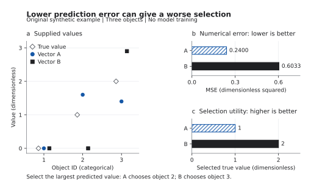

# 回归误差与筛选收益：原创合成反例

## 冻结契约与边界

三个对象的无量纲真实值固定为 (0,1,2)，越大越好。两个预测向量是人为设计的算例输入，不是模型拟合或观测数据：A=(0,1.6,1.4)，B=(0,0,2.9)。比较均方误差，以及按预测最大值选一个对象后取得的真实值。后悔值定义为真实最大值减所选对象真实值；它与标签同量纲。MSE为标签量纲平方，不能直接把两者相加。预测并列时拒绝计算，要求先确定并列规则。

这是为[RankReg候选审查](../RankReg_排序与回归.md)构造的评价反例，不是RankReg实现、酶工程数据、训练外效果、因果证据或新算法。没有训练、调参、抽样或随机性，因此不虚构训练集、种子或置信区间。`source:FRONTIER-METRIC-COUNTEREXAMPLE-2026`。

## 实际结果与解释

| 固定预测向量 | MSE（精确分数） | 所选对象真实值 | 后悔值 |
|---|---:|---:|---:|
| A | 6/25 = 0.24 | 1 | 1 |
| B | 181/300 ≈ 0.603333 | 2 | 0 |

A的数值误差更小，却未选中真实值最大的对象。B在这里的筛选收益更高，但数值误差更大；不能只报其中一个指标就称某方法全面更好。这个反例只推翻“两种评价必然一致”，不说明它们总是冲突，更不证明增加排序损失一定有效。

## 运行与检查

在本目录运行 `python run_tradeoff.py` 生成结果，运行 `python run_tradeoff.py --check` 核对完整保存结果和脚本指纹。仅依赖Python标准库，写入仅为本目录的results.json。精确分数计算避免把舍入误差当排序变化。

8项检查覆盖独立手算值、指标方向冲突、所选收益、全部6个对象同步置换、共同平移、正比例缩放、完美预测边界，以及空/长度不符/预测并列输入拒绝。具体布尔结果见[结果文件](results.json)。同值平移不改变误差，正比例放大使MSE平方缩放、后悔值线性缩放；这些检查验证算例与评价实现，不替代实际模型验证。

## 如何连接真实建模与英文论证

任务确有top-k筛选目标时，先冻结k、并列处理、收益定义、信息可得时点和验证对象；在同一外层划分上同时检查数值误差和筛选收益，再决定是否值得添加排序模块。若只要求数值预测，不应因为本例而强加排序任务。标签相关或时序依赖时，验证划分必须匹配结构。

英文结果段（明确为合成算例）：

> In this synthetic example, vector A has a lower mean squared error (0.24 versus 0.603333), but it selects an object with a true value of 1 rather than 2. Numerical accuracy and selection utility therefore favor different vectors in this construction. This does not establish that a ranking-aware model will improve either metric on real data.

## 同源图与英文图注（2026-11-01）

英文图注：

> **Numerical error and selection utility in a synthetic example.** (a) True values and two supplied prediction vectors for three objects; horizontal offsets separate symbols within each categorical object. (b) Mean squared error across all three objects. (c) The true value of the object selected by the largest predicted value. Vector A has lower error (0.24 versus approximately 0.6033), but selects a lower-value object (1 versus 2). Values are dimensionless; MSE has squared units. These are fixed, untrained vectors, so no sampling intervals are shown. This construction does not establish a performance advantage for a ranking-aware model.

这张图服务“评价指标怎样连接最终决定”的论证，不能用来证明真实模型胜负。a展示全部输入，不连接独立对象形成趋势；b和c各用独立零起点轴、标明方向和单位，不合并成总分或使用双轴。蓝色圆点/斜线条表示A，黑色方点/实心条表示B，真实值为空心菱形，灰度下仍有形状和纹理冗余。

下载：[彩色PNG](metric-tradeoff.png)、[灰度PNG](metric-tradeoff-gray.png)、[矢量PDF](metric-tradeoff.pdf)、[矢量SVG](metric-tradeoff.svg)。底稿仍是[唯一结果文件](results.json)，导出与软件指纹见[图表清单](figure-manifest.json)。`source:FRONTIER-METRIC-COUNTEREXAMPLE-2026`。

绘图命令为 `python plot_tradeoff.py`，默认只读本目录results.json并在本目录写入上述四幅图和图表清单；也可用 `--input`、`--output` 指定输入及产物目录。先运行 `python run_tradeoff.py --check`，再绘图。绘图入口不会拟合模型、导入上游仓库或改写结果；它重新用精确分数核对两个向量的MSE、选中对象与后悔值，绘制时才转换为浮点。

本次实际环境为Python 3.12.7、Matplotlib 3.9.2、Pillow 10.4.0；直接依赖可按 `matplotlib==3.9.2 pillow==10.4.0` 安装，这不是传递依赖锁或已完成干净安装证明。导出180×108毫米、PNG 2125×1275像素、约300 dpi、最小9点；SVG转文字路径以保留外观，PDF嵌入TrueType字体。没有指定投稿期刊，尺寸为通用备赛示例，不声称期刊合规。导出接口依据[对应版本的Matplotlib文档](https://matplotlib.org/3.9.2/api/_as_gen/matplotlib.figure.Figure.savefig.html)；`source:MPL-FIGURE-EXPORT-392`。

审查时分别核对数值来源、所有对象是否完整、坐标轴、输入与被选对象、图注边界、最终尺寸和灰度。自动文字边界检查仅检测画布外文字；不能发现所有图内重叠，不能代替实际查看。当前图已查看彩色/灰度及网页预览；实际论文整页和独立读者验收仍待对应交付时完成。

绘图流程参考 scientific-visualization 技能；程序和图像为本库原创。技能方法来源：Kassis, T., Agarwal, V., He, Y., Patel, D., & Brueckner, A. M. (2026). [Scientific Agent Skills: A Library of Procedural Knowledge for Research Agents](https://doi.org/10.48550/arXiv.2609.00065)，2026-11-01核对当前记录v2，仅作为流程出处，不支持本例的模型效果。`source:SCIENTIFIC-AGENT-SKILLS-2026`。

## 英文结论怎样保留取舍与决策接口（2026-11-07）

本节是对既有合成结果的表达练习，不改变输入、计算或图像。先确认本例只按预测最大值选一个对象，评价使用该对象的真实值；A、B是人为输入向量，不是已训练的模型。既有数值来源仍为[结果文件](results.json)。`source:FRONTIER-METRIC-COUNTEREXAMPLE-2026`。

下面是为训练专门构造的错误结论：

> A is more accurate, so it is the best model. B doubles performance and proves that ranking-aware learning is superior. We recommend this method for all prediction tasks.

第一句把一个数值指标扩展为总体最优，第二句未定义performance的口径并把输入向量冒充算法，第三句扩大任务范围。可改为一个独立可读的英文结论段：

> In this constructed example, we select one of three objects by its largest predicted value. Vector A has lower mean squared error (0.24 versus approximately 0.603333), while vector B selects an object with a higher true value (2 versus 1). If the sole objective in this example is the selected object's true value, the decision criterion favors B. If accurate numerical prediction is also required, neither vector is better on both reported criteria. The example motivates evaluating prediction error and selection utility together; it does not identify a suitable learning algorithm or establish performance on real data.

英文段落按“任务—两项结果—条件决策—取舍—外推边界”衔接。只在本例已给出的向量间比较；不能由此建议采用RankReg，也不能删掉题目要求的数值预测答案。真实项目的每问应分别保留输出：预测问给误差与匹配验证，筛选问给所选对象、收益与约束，最终建议回指任务目标及仍缺证据。

| 语义核对 | 保留内容 | 会失真的改写 |
|---|---|---|
| 身份 | constructed vectors，合成输入 | trained models / measured data |
| 指标方向 | A的MSE更低，B的所选真实值更高 | A is better on every criterion |
| 比较范围 | 只在A与B及本例两项指标间比较 | the best available algorithm |
| 决策对象 | 从3个对象中选1个 | top-k选择的一般实验结论 |
| 所选收益 | 2对1，真实值为人为给定 | 预测最大值2.9就是实际收益 |
| 总体判断 | 两项指标互有取舍 | 用单一指标隐去另一项失败 |
| 方法建议 | 先评价两项目标，学习算法待验证 | ranking loss is proven superior |
| 不确定性 | 无抽样、无统计推断 | statistically significant / guaranteed |

本例的2对1也不应直接写成“实际收益普遍提高100%”：它只有一个人为构造且以此零点定义的比较，不是现实改进幅度。润色检查先核对对象、单位、范围和条件，再核数字；数字不变并不保证结论保真。

遮住正文后，用上述英文复述：选什么、依什么规则、谁在哪项指标占优、何时才偏向B、为什么还不能决定采用哪种算法。此为代理文字自审；独立读者反馈仍待执行。没有新增性能、模型实验或视觉验收。
